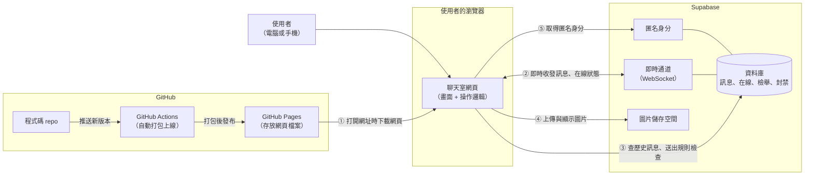

# 匿名聊天室 架構文件

> 這份文件寫給不寫程式的人看。專有名詞第一次出現時會用一句話解釋。
> 文件只描述「要做什麼、為什麼這樣做」，不含程式碼；畫面的顏色與樣式由 /design 決定，不在這裡規定。

---

## 1. 專案說明與目標

### 這是什麼

一個不用註冊、不用登入的匿名聊天室。所有人都在同一個房間，知道網址的人都能進來，電腦和手機都能用。

### 使用者會經歷的流程

1. 打開網頁。
2. 輸入一個代號（暱稱）。
3. 進入聊天室，看到所有歷史訊息，也能送出文字或圖片。
4. 想離開時按「離開」，回到輸入代號的畫面，可以換一個新代號。

### 已經確認的產品規則

| 項目 | 決定 |
|---|---|
| 歷史訊息 | 新進來的人可以看到全部歷史（用分批載入的方式，見第 6 節） |
| 代號 | 1 到 12 個字，只能用中文、英文、數字；不能和「目前在線」的人重複 |
| 重新整理或關掉再打開 | 瀏覽器記住代號，直接進入聊天室，不用再輸入 |
| 離開 | 有「離開」按鈕；按了之後回到輸入代號的畫面，可以換代號 |
| 訊息種類 | 文字、上傳圖片、貼圖片網址；表情符號直接用手機或電腦內建的輸入法打 |
| 圖片太大 | 自動壓縮後再送出 |
| 訊息外觀 | 顯示代號與時間；自己的訊息靠右、別人的靠左，顏色不同 |
| 誰在線上 | 畫面上方一條小列顯示人數，點開才展開名單 |
| 進出提示 | 在訊息中間插入一行灰色小字（例如「小明 進入了聊天室」），並永久留在歷史裡 |
| 斷線 | 畫面上方顯示「連線中斷，重新連線中…」；恢復後自動繼續，並補上漏掉的訊息 |
| 往上捲看舊訊息時有新訊息 | 不打斷閱讀，底部顯示「有 N 則新訊息 ↓」按鈕，點了才捲到底 |
| 送出後 | 不能編輯、不能刪除、不能收回 |
| 防洗版 | 限制送出頻率；同一人被 3 個不同人檢舉，就自動踢出，1 小時內不能再用同一個代號 |
| 外觀風格 | 亮色、暗色等，交給 /design 決定 |

### 目標

- 先做出完整的前端，放上 GitHub Pages，任何人打開網址就能看到、操作到。
- 最後再接上 Supabase，讓不同的人真的能即時對話。
- 兩個階段之間，畫面的程式不需要重寫。

---

## 2. 整體架構圖

先解釋圖裡的三個角色：

- **瀏覽器**：使用者手上的 Chrome、Safari 等。聊天室的畫面和操作邏輯都在這裡執行。
- **GitHub Pages**：GitHub 提供的免費網頁空間。它只負責「把網頁檔案交給瀏覽器」，自己不執行任何程式，也不存任何聊天內容。
- **Supabase**：一個現成的後端服務（你不用自己架伺服器）。聊天訊息、在線名單、圖片都在這裡。



**怎麼讀這張圖：**

- ① 使用者打開網址，瀏覽器從 GitHub Pages 把網頁下載回來。**之後的聊天內容都不再經過 GitHub Pages。**
- ②～⑤ 網頁在使用者的瀏覽器裡執行，直接和 Supabase 溝通。
- 階段一時，②～⑤ 還不存在，網頁用「假資料」代替 Supabase（見第 4 節）。

**WebSocket 是什麼：** 一種讓瀏覽器和伺服器保持「一直連著」的通訊方式。伺服器有新訊息時可以立刻推給你，不用你一直問「有新訊息嗎？」。

---

## 3. 技術選擇

每一項都寫「選了什麼」和「為什麼」。

### 3.1 前端

**語言：TypeScript**

- 是什麼：JavaScript（網頁的標準程式語言）的加強版，會要求每筆資料都先說明它的「形狀」，例如「訊息一定有代號、內容、時間」。
- 為什麼：聊天室裡有很多固定格式的資料（訊息、在線名單、錯誤）。寫錯格式時，工具會在上線前就提醒，而不是等使用者遇到才發現。

**框架：React**

- 是什麼：框架是一套現成的積木規則，幫你把畫面拆成小零件（例如「一則訊息」「上方人數列」），資料變了零件會自動更新。
- 為什麼：聊天室的畫面一直在變（新訊息、有人進出、連線狀態），React 擅長處理這種「資料一變，畫面自動跟著變」的情況。生態系也最大，遇到問題最容易找到解答。

**打包工具：Vite**

- 是什麼：把我們寫的零散程式檔，整理成瀏覽器能直接讀的一包檔案（這個動作叫「打包」或「建置」）。
- 為什麼：速度快、設定少，而且打包出來的是**純靜態檔案**，正好符合 GitHub Pages「只能放靜態檔案」的限制。

**為什麼不用 Next.js 等需要伺服器的框架：** GitHub Pages 不能執行伺服器程式，用了也用不上。

### 3.2 後端：Supabase 的哪些功能

Supabase 是一組功能的集合，這個專案用其中四個：

| 需求 | 選用的 Supabase 功能 | 為什麼 |
|---|---|---|
| 認出「同一個人」 | **匿名登入**（Anonymous sign-in） | 使用者什麼都不用填，網頁自動向 Supabase 要一個「匿名身分證」。我們需要它來做檢舉、踢出、限制頻率，因為光靠代號無法認出同一個人（代號可以換）。這**不是**要求使用者登入，使用者完全感覺不到 |
| 即時收到新訊息 | **Realtime 的資料庫變更訂閱**（Postgres Changes） | 訊息一律先存進資料庫，資料庫再通知所有人。好處是「即時看到的」和「歷史裡的」永遠是同一份，不會有人看到的和別人不同 |
| 誰在線上 | **Realtime Presence** | Presence 是 Supabase 內建的「在線名單」功能，每個人連上線就自動加入，關掉分頁或斷網就自動移除，不用我們自己維護名單 |
| 上傳圖片 | **Storage**（檔案儲存空間） | 圖片檔放在這裡，訊息裡只存圖片的網址，資料庫不會被大檔案塞滿 |
| 規則把關 | **資料庫規則**（RLS、trigger、RPC，下面解釋） | 見下一段 |

**資料庫規則的三個詞：**

- **RLS（Row Level Security，列級安全）**：資料庫自己的門禁，規定「誰可以讀、誰可以寫哪些資料」。
- **trigger（觸發器）**：資料庫裡的自動反應，例如「有人寫入訊息時，自動檢查他是不是發太快」。
- **RPC（遠端函式）**：事先在資料庫裡寫好的一套動作，網頁只要說「執行這個」。例如「進入聊天室」會一次完成「檢查代號、檢查有沒有被封、登記在線、寫入進入提示」，中間不會被別人插隊。

**為什麼規則要放在資料庫，而不是網頁裡：** 網頁的程式和金鑰都是公開的，任何人都能繞過畫面，直接對 Supabase 發請求。所以「真正的守門員」必須在資料庫，網頁裡的檢查只是為了讓正常使用者早點得到提示。

### 3.3 其他

| 項目 | 選擇 | 為什麼 |
|---|---|---|
| 網頁空間 | GitHub Pages | 你指定的；免費、和 repo 整合 |
| 自動上線 | GitHub Actions | GitHub 內建的自動化機器人。你把新版本推上去，它會自動打包並發布，不用手動上傳 |
| 畫面設計 | /design 與 /frontend-design | 你指定的；本文件只規定「有哪些畫面與行為」，不規定外觀 |

---

## 4. 兩個階段，以及如何不用重寫

### 4.1 核心設計：把「聊天功能」做成一個插座

前端程式裡，所有和「聊天資料」有關的事（進入、送訊息、收訊息、離開、檢舉、查在線名單），**都只透過一個統一的介面（暫稱「聊天服務」）來做**。畫面完全不知道背後是假資料還是真的 Supabase。

可以想成牆上的插座：畫面是電器，只認插座的形狀。

- 階段一：插座後面接「模擬版」（假資料，全部在瀏覽器裡）。
- 階段二：把插座後面換成「Supabase 版」。

這個插座的「形狀」，就是第 5 節的通訊約定（事件名稱和資料格式）。**兩邊都遵守同一份約定，所以換的時候畫面一行都不用改。**

### 4.2 階段一：還沒接 Supabase

**做到什麼程度：**

第 7 節列的**所有畫面和行為**都要完成並能操作，包括：輸入代號、代號重複的錯誤、聊天、傳文字和圖片、圖片壓縮、在線名單、進出提示、往上捲時的「N 則新訊息」按鈕、斷線提示、被踢出畫面。

**資料從哪來：** 由「模擬版聊天服務」提供：

- 內建幾個「假使用者」，會定時說話、進出，讓畫面看起來像有人在用。
- 訊息與代號存在瀏覽器自己的儲存空間裡，重新整理後歷史還在，「記住代號直接進入」也能測。
- 同一台電腦開兩個分頁，可以互相聊天（模擬版會在分頁間同步），方便測試「代號重複」和「在線名單」。
- 提供幾個只有測試時會出現的開關，例如「模擬斷線」「模擬被踢出」，用來檢查那些很難自然遇到的畫面。

**怎麼在 GitHub Pages 看到效果：** 打包後發布到 GitHub Pages（方式見第 12 節），你和別人就能用網址打開。**階段一有一個明顯的限制：不同人、不同裝置之間不會真的互通**，每個人看到的是自己瀏覽器裡的模擬世界。這是預期的，頁面上建議放一行小字標示「展示版」。

### 4.3 階段二：接上 Supabase

**改變的事：**

1. 在 Supabase 建立專案、開啟匿名登入、建立資料表與規則、建立圖片儲存空間（細節見第 8 節與第 6 節）。
2. 新增「Supabase 版聊天服務」，換掉「模擬版」。
3. 設定金鑰（見第 8 節）。
4. 重新打包上線。

**不變的事：** 所有畫面、所有操作流程、所有文字提示。

**會多出來的東西（因為真的有網路了）：**

- 真正的斷線與重連。
- 真正的代號衝突（兩個人同時搶同一個代號，由資料庫裁決）。
- 真正的頻率限制與檢舉踢出（由資料庫執行）。
- 模擬版的假使用者和測試開關關閉。

---

## 5. 通訊約定：事件名稱與資料格式

「事件」就是「發生了某件事的通知」，例如「有人進來了」。畫面只需要關心這些事件。階段一和階段二都要遵守這一份約定。

### 5.1 資料格式

**一則訊息**

| 欄位 | 意義 | 範例 |
|---|---|---|
| id | 訊息編號，由小到大，用來排序與去重 | 1024 |
| type | 種類：`text`（文字）、`image`（圖片）、`system`（系統提示） | text |
| nickname | 發送者代號；系統提示沒有發送者時為空 | 小明 |
| senderId | 發送者的匿名身分編號；系統提示為空。畫面用它判斷「是不是我自己」和「檢舉誰」 | 一串隨機字元 |
| content | 內容。文字訊息是文字；圖片訊息是圖片網址；系統提示是提示文字 | 你好 |
| createdAt | 送出時間，由伺服器決定（不信任使用者的手機時鐘） | 2026-10-13 14:32:05 |

**一位在線者**

| 欄位 | 意義 |
|---|---|
| nickname | 代號 |
| senderId | 匿名身分編號 |

**連線狀態**：`connected`（正常）、`reconnecting`（重連中）、`kicked`（被踢出）。

**錯誤代碼**（畫面依代碼顯示對應的中文提示）

| 代碼 | 意思 | 畫面提示 |
|---|---|---|
| nickname_invalid | 代號格式不符 | 代號需為 1–12 個中文、英文或數字 |
| nickname_taken | 代號正在被使用 | 這個代號已被使用 |
| banned | 被踢出，尚未解除 | 你已被踢出聊天室，約 X 分鐘後可再進入 |
| rate_limited | 送太快 | 請稍後再送 |
| message_too_long | 文字太長 | 訊息太長 |
| image_too_large | 圖片壓縮後仍太大 | 圖片太大，無法送出 |
| image_type_unsupported | 不是支援的圖片類型 | 不支援這種圖片 |
| image_url_invalid | 圖片網址不合規定 | 圖片網址無效 |
| network | 網路問題 | 連線中斷，重新連線中… |

### 5.2 畫面對聊天服務下的指令

| 指令 | 說明 | 成功時 | 失敗時 |
|---|---|---|---|
| join(代號) | 進入聊天室 | 回傳可用的初始資料 | 錯誤代碼：nickname_invalid、nickname_taken、banned |
| leave() | 離開聊天室 | 完成 | — |
| sendText(文字) | 送出文字 | 完成 | rate_limited、message_too_long、banned |
| sendImageFile(圖片檔) | 壓縮並上傳圖片，再送出 | 完成 | image_too_large、image_type_unsupported、rate_limited |
| sendImageUrl(網址) | 送出圖片網址 | 完成 | image_url_invalid、rate_limited |
| report(對象的 senderId) | 檢舉某人 | 完成 | 無（同一人重複檢舉時靜默忽略） |
| loadOlder(最舊那則的 id) | 往上捲時載入更早的 50 則 | 回傳訊息陣列與「是否還有更多」 | network |

### 5.3 聊天服務通知畫面的事件

| 事件名稱 | 何時發生 | 帶的資料 |
|---|---|---|
| message:new | 有新訊息（包含系統提示，也包含自己送出的） | 一則訊息 |
| presence:sync | 在線名單有變動 | 完整的在線者清單 |
| connection:lost | 偵測到斷線 | — |
| connection:restored | 重新連上 | 斷線期間漏掉的訊息陣列（已按時間排序） |
| session:kicked | 我被踢出 | 解除時間 |

**設計重點：**

- 「有人進來／離開」的灰色小字，**就是一則 type 為 system 的 message:new**，不是另外的事件。因為它要留在歷史裡，所以必須和一般訊息一樣被存起來、被分批載入。
- 「在線名單」是另一條線（presence:sync），因為它只反映「現在」，不需要留歷史。

---

## 6. 資料流

### 6.1 進入聊天室

1. 打開網頁，網頁先看瀏覽器有沒有記住的代號。
2. 沒有 → 顯示「輸入代號」畫面；有 → 跳過這一步。
3. 前端先檢查代號格式（長度、字元），不合就直接提示，不送出。
4. 呼叫 `join(代號)`。階段二時，這一步由資料庫一次完成：
   - 檢查是否被封（被封 → `banned`）。
   - 登記代號（若已有「別的人」在線上用了 → `nickname_taken`；若是**同一個人**重新整理回來，視為同一人，不算重複）。
   - 寫入一則「某某 進入了聊天室」系統提示。
5. 成功後：載入最新 50 則歷史、開始接收新訊息與在線名單，顯示聊天室，並把代號記在瀏覽器裡。
6. 失敗後：顯示對應的錯誤提示，停留在「輸入代號」畫面。如果是「記住的代號」造成的失敗（例如剛好被別人占用），清掉記住的代號，回到輸入畫面。

**歷史訊息為什麼要分批：** 要讓新人能看到「全部歷史」，但一次載入幾萬則會很慢。做法是先載最新 50 則；往上捲到頂端時，再載入更早的 50 則，直到沒有更多。看起來是「全部都看得到」，實際上是「需要時才載入」。載入更早的訊息時，畫面位置不能跳動。

### 6.2 送出訊息

**文字：**
1. 去掉頭尾空白；空白訊息不送。
2. 檢查長度（上限 1000 字）。
3. 呼叫 `sendText`。
4. 資料庫檢查：你是否在線、有沒有被封、距離上一則是否至少 1 秒。通過就存下來。
5. 資料庫通知所有人（包含你自己）→ `message:new` → 畫面顯示。**自己的訊息也是等這個通知才顯示**，這樣你看到的和別人看到的完全一致。送出的那一瞬間，送出鈕暫時停用，避免連點。

**上傳圖片：**
1. 檢查檔案類型（JPEG、PNG、WebP、GIF）。
2. 若檔案太大 → 在瀏覽器裡自動壓縮（縮小尺寸、降低畫質）。GIF 壓縮會失去動畫，所以 GIF 太大就直接提示 `image_too_large`。
3. 上傳到圖片儲存空間，拿到圖片網址。
4. 以「圖片訊息」的形式送出，後續和文字相同。

**貼圖片網址：**
1. 前端檢查網址必須是 `https://` 開頭。
2. 送出為圖片訊息。顯示時若圖片載入失敗，顯示「圖片無法載入」的替代框。

**被擋下時：** 顯示第 5.1 節對應的提示，輸入框內容保留，使用者不必重打。

### 6.3 離開

1. 使用者按「離開」。
2. 呼叫 `leave()`：從在線名單移除、寫入一則「某某 離開了聊天室」系統提示。
3. 清掉瀏覽器記住的代號，停止接收訊息。
4. 回到「輸入代號」畫面，可以用新代號進入。

**如果使用者沒按離開，直接關掉分頁或斷網呢？** 這時網頁沒有機會通知伺服器。階段二的做法：網頁每 20 秒向伺服器報一次平安；伺服器定期檢查，超過約 60 秒沒報平安的人，視為已離開，自動移出在線名單、補寫「離開」系統提示。這樣代號不會被「已經不在的人」一直占著。

### 6.4 斷線重連

1. 偵測到斷線 → `connection:lost` → 畫面上方顯示「連線中斷，重新連線中…」，輸入框暫時不能送出。
2. 網頁在背景自動重試連線。
3. 連上後 → 查詢「我手上最後一則訊息的時間點」之後的所有訊息，補在畫面最後 → `connection:restored` → 提示消失。
4. **特殊情況：斷線超過約 60 秒**，伺服器已經把你視為離開（見 6.3）。重連後網頁要自動再執行一次進入流程；若這段時間代號被別人占走，就回到「輸入代號」畫面並提示「這個代號已被使用」。
5. 補訊息時要去重：用訊息 id 判斷，已經有的不重複顯示。

### 6.5 檢舉與踢出

1. 使用者在別人的訊息或在線名單上選「檢舉」→ `report(對象)`。
2. 資料庫記錄這筆檢舉。**同一人對同一個對象只算一次；不能檢舉自己。**
3. 資料庫統計：該對象在最近 1 小時內，被「不同人」檢舉了幾次。達 3 人 → 封禁 1 小時，從在線名單移除，寫入「某某 被踢出了聊天室」系統提示。
4. 被踢者的畫面收到 `session:kicked`，顯示「你已被踢出聊天室」，回到輸入代號畫面。
5. 1 小時內，被封的匿名身分與被封的代號都不能再進入（`banned`）。

---

## 7. 畫面清單

只規定「有哪些畫面、有什麼元素、做什麼事」，不規定外觀。手機與電腦共用同一套畫面，版面自動適應。

### 7.1 輸入代號畫面

**什麼時候出現：** 第一次來、按了「離開」、被踢出之後、重連時代號被占走。

| 元素 | 行為 |
|---|---|
| 標題／簡短說明 | 說明這是匿名聊天室、不用登入 |
| 代號輸入框 | 輸入時即時提示格式是否符合（1–12 個中文、英文、數字）；不合格式時不能送出 |
| 「進入」按鈕 | 按下後呼叫進入；處理中顯示載入狀態並停用，避免連點 |
| 錯誤提示區 | 顯示「這個代號已被使用」「格式不符」等；使用者開始修改輸入框時消失 |
| 被踢出提示 | 若是被踢出後來到這裡，顯示「你已被踢出聊天室，約 X 分鐘後可再進入」 |
| （階段一）展示版標示 | 一行小字，說明目前是展示版 |

### 7.2 載入中畫面

重新整理且有記住的代號時，短暫顯示「正在進入聊天室…」，成功就切到聊天室，失敗就切回輸入代號畫面。

### 7.3 聊天室畫面

分成四個區塊：

**(a) 上方列**

| 元素 | 行為 |
|---|---|
| 房間名稱 | 純顯示 |
| 在線人數 | 顯示「N 人在線」，即時更新；點一下展開或收起在線名單 |
| 「離開」按鈕 | 按下後先跳出確認（避免誤按），確認後執行離開流程 |
| 連線狀態條 | 平常隱藏；斷線時顯示「連線中斷，重新連線中…」，恢復後消失 |

**(b) 在線名單（點人數後展開）**

| 元素 | 行為 |
|---|---|
| 每位在線者的代號 | 自己的那一列有標示「我」 |
| 「檢舉」入口 | 每位別人的那一列有；按下後要再確認一次，並說明「3 人檢舉會讓對方被踢出」 |
| 再點一次人數或點空白處 | 收起名單 |

**(c) 訊息列表**

| 元素 | 行為 |
|---|---|
| 文字訊息 | 顯示代號、內容、時間；自己的靠右、別人的靠左；文字當純文字顯示，網址不會變成可執行的內容 |
| 圖片訊息 | 縮圖顯示；點擊可放大查看；載入失敗顯示「圖片無法載入」 |
| 系統提示 | 一行置中的灰色小字（進入、離開、被踢出） |
| 別人的訊息上的「檢舉」入口 | 長按（手機）或滑過（電腦）後出現；行為同上 |
| 捲動行為 | 剛進入時停在最底；使用者在底部附近時，新訊息自動捲到底 |
| 往上捲到頂端 | 自動載入更早的 50 則，位置不跳動；顯示載入中；沒有更多時顯示「已經是最早的訊息」 |
| 「有 N 則新訊息 ↓」按鈕 | 使用者不在底部時才出現，數字隨新訊息增加；點了捲到底並消失 |
| 空狀態 | 還沒有任何訊息時顯示「還沒有人說話，來打個招呼吧」 |

**(d) 輸入區**

| 元素 | 行為 |
|---|---|
| 文字輸入框 | 可多行；Enter 送出，Shift+Enter 換行（手機上以送出鈕為主） |
| 「送出」按鈕 | 空白時停用；送出中停用 |
| 「選圖片」按鈕 | 開啟手機相簿或電腦檔案選擇器；選好後先顯示預覽，使用者確認才送出 |
| 「貼圖片網址」入口 | 開啟一個小輸入框貼網址，確認後預覽並送出 |
| 錯誤提示 | 被擋下時在輸入區上方顯示一行提示（例如「請稍後再送」），數秒後消失；輸入內容保留 |
| 斷線時 | 輸入區顯示為不可用，並提示連線中 |

### 7.4 被踢出畫面

可與輸入代號畫面合併：顯示「你已被踢出聊天室」，並說明可再進入的時間；時間到之前不能進入。

### 7.5 手機特別注意

- 虛擬鍵盤跳出時，輸入區不能被擋住。
- 所有按鈕要大到手指好按。
- 輸入框的文字不能太小，否則部分手機會自動放大畫面。

---

## 8. 金鑰

「金鑰」是程式用來向 Supabase 證明身分的一長串字元。這個專案會碰到的東西如下。

| 名稱 | 是什麼 | 能做什麼 | 能公開嗎 |
|---|---|---|---|
| **專案網址**（Project URL） | 你的 Supabase 專案的位址 | 單純是地址 | 可以 |
| **公開金鑰**（anon key，新版介面可能叫 publishable key） | 給瀏覽器用的金鑰 | 只能做第 3.2 節「資料庫規則」允許的事 | **可以公開**，它本來就會被包在網頁裡，任何人打開網頁都看得到 |
| **管理金鑰**（service_role key，新版介面可能叫 secret key） | 管理員金鑰 | **無視所有規則**，可讀寫、刪除全部資料 | **絕對不能公開**。這個專案完全用不到它，所以根本不要把它複製出來 |
| **資料庫密碼** | 建立專案時你設定的密碼 | 直接連進資料庫 | **絕對不能公開**。只在後台操作資料庫時用，不放進專案檔案 |
| GitHub 的存取權杖 | — | — | 這個專案不需要。GitHub Actions 部署用的是 GitHub 自動提供的權限，不用你另外產生 |

### 怎麼產生

公開金鑰與專案網址：到 Supabase 後台，進入你的專案，在專案設定的 API 頁面可以看到。不需要寫程式產生，複製即可。（介面名稱可能隨 Supabase 改版而不同，以後台實際顯示為準。）

### 放在哪裡

- **本機測試：** 放在專案根目錄一個叫 `.env.local` 的檔案裡（兩行：專案網址、公開金鑰）。
- **上線後：** 放在 GitHub repo 的設定裡（Settings → Secrets and variables → Actions）。GitHub Actions 打包時會讀取，並把它們包進網頁。
- **為什麼公開金鑰也要這樣放，既然可以公開？** 因為這樣更換專案或金鑰時只要改設定，不用改程式；也是良好習慣，避免之後有人把真正敏感的東西也照樣放進程式裡。

### 為什麼「公開金鑰被看到」不是問題

公開金鑰就像「大樓的訪客證」，能進哪些門由大樓的門禁（資料庫規則）決定。所以**安全性來自資料庫規則是否都設對，而不是把公開金鑰藏起來**。因此有一條硬規定：**每一張資料表都必須啟用規則；沒寫允許的事，一律拒絕。**

### 怎麼避免被 commit 到 GitHub

1. 在 repo 的忽略清單（`.gitignore`）裡列入 `.env.local` 等環境檔，讓 git 根本不會追蹤它們。
2. repo 裡只放一份 `.env.example`，只有變數名稱、沒有真實值，讓別人知道要填什麼。
3. 每次 commit 前看一眼變更清單，確認沒有 `.env` 類的檔案。
4. 在 GitHub 啟用 Secret scanning 與 Push protection（GitHub 內建功能，推送含有疑似金鑰的內容時會擋下並警告）。
5. **萬一管理金鑰或資料庫密碼不小心推上去了：** 不要只是刪掉檔案（歷史紀錄裡還在）。立刻到 Supabase 後台重新產生金鑰／重設密碼，讓舊的作廢。

---

## 9. 安全與限制

### 9.1 別人可能送什麼奇怪的東西進來

原則：**前端的檢查是為了讓好人得到好的提示；資料庫的檢查才是真正的防線。**所有重要規則兩邊都做。

| 可能的情況 | 前端怎麼處理 | 資料庫的後盾（階段二） |
|---|---|---|
| 訊息裡夾帶網頁程式碼（例如想讓別人的畫面執行惡意指令） | 所有訊息一律當「純文字」顯示，絕不當成網頁內容解讀 | 無法也不需要，因為危險出在「顯示」這一步 |
| 超長的訊息 | 限制 1000 字 | 同樣限制 |
| 一直狂刷訊息 | 兩則之間至少隔 1 秒，並提示「請稍後再送」 | 同樣限制，且是真正擋得住的那一層 |
| 假冒別人的代號發言 | — | 只允許用自己登記的代號發言 |
| 偽造「系統提示」（例如假裝「管理員已踢出某人」） | — | 一般使用者完全沒有寫入系統提示的權限，只有資料庫自己的流程能寫 |
| 改或刪別人（或自己）的訊息 | 沒有這些按鈕 | 資料庫不開放任何修改或刪除 |
| 代號放特殊字元、空白、很像別人名字的符號、不可見字元 | 只允許中文、英文、數字，長度 1–12 | 同樣驗證 |
| 圖片網址是 `http://`、`javascript:` 或奇怪格式 | 只接受 `https://` 開頭的網址 | 同樣驗證 |
| 圖片網址指向很大的圖或不是圖片 | 載入失敗就顯示替代框；用延遲載入，不讓一張圖拖垮整頁 | — |
| 上傳的不是圖片，或副檔名偽裝 | 檢查檔案類型 | 圖片儲存空間只收 JPEG、PNG、WebP、GIF，並限制大小 |
| 上傳超大檔案 | 先在瀏覽器壓縮 | 儲存空間有大小上限（暫定 2 MB） |
| 把圖片傳到別人的資料夾、覆蓋別人的圖片 | — | 每個人只能寫入自己的資料夾，且不能覆蓋 |
| 同一個人亂檢舉很多人／灌檢舉票 | — | 同一人對同一對象只算一票；要不同的 3 個人才會踢出 |
| 繞過畫面，直接用程式打 API | — | 以上所有規則都在資料庫，繞不過去 |

### 9.2 已知的限制（誠實說明）

- **匿名身分綁在瀏覽器上。** 被踢的人清除網站資料，或換一個瀏覽器，就會拿到新的匿名身分，可以換個代號再進來。這是「不登入」的必然代價。目前的做法（3 人門檻 + 1 小時）擋住的是一般洗版，擋不住刻意的人。
- **外部圖片會洩漏觀看者的網路位址。** 別人貼一個外部圖片網址，大家的瀏覽器會去那個網站下載圖片，該網站就看得到這些人的 IP。這是「支援貼網址」的固有代價。
- **內容審核。** 沒有人工管理員，不雅或違法的圖片只能靠檢舉機制處理。
- **歷史永久保留。** 沒有清理機制，資料會一直增加（見下一節的上限）。

### 9.3 免費方案的上限

**注意：以下是撰寫時的大致範圍，各服務會調整方案，接上 Supabase 前請到官方方案頁面再確認一次。**

**Supabase 免費方案（需留意的項目）**

| 項目 | 可能影響 |
|---|---|
| 同時連線數（Realtime）有上限，約為兩百個等級 | 同時在線人數太多時，新的人連不上 |
| 即時訊息的每秒與每月數量有上限 | 人多又很熱絡時可能超過 |
| 資料庫容量有上限（約數百 MB） | 文字很省空間，通常不是問題 |
| 圖片儲存空間與每月下載流量有上限（約 GB 等級） | **最可能先用完的是這裡**，因為圖片會被每個新進來的人重新下載 |
| 閒置一段時間（約一週）沒有任何活動，專案會被暫停 | 暫停期間聊天室無法使用，需要到後台手動恢復 |

**GitHub Pages**

| 項目 | 可能影響 |
|---|---|
| 網站大小與每月流量有上限 | 我們的網頁很小，一般不會碰到 |
| 免費帳號通常需要 repo 是公開的才能用 Pages | repo 內容（包含程式碼）任何人看得到，所以更要確認沒有放機密 |

**因應：** 圖片壓縮與 2 MB 上限就是為了節省儲存與流量；若真的達到上限，再考慮升級方案或限制圖片功能。

---

## 10. 這一版刻意不做的事

| 不做 | 為什麼 |
|---|---|
| 註冊、登入、帳號 | 你明確不需要；匿名是產品核心 |
| 編輯、刪除、收回訊息 | 你選擇送出就不能更改；也讓系統簡單，歷史穩定可信 |
| 私訊、多個聊天室 | 需求是「所有人在同一個聊天室」 |
| 貼圖選單、表情選單 | 直接用系統內建的表情輸入法即可，做選單是額外工作 |
| 管理員後台、人工封鎖名單 | 目前靠「3 人檢舉自動踢出」處理；管理員功能留給有需要時再加 |
| 封鎖（只讓自己看不到某人） | 你選的是「檢舉並自動踢出」，不是個人封鎖 |
| 通知（推播、聲音） | 需求沒有提到，且涉及瀏覽器授權，留待之後 |
| 訊息搜尋、已讀、正在輸入中 | 需求沒有提到，每一項都會增加複雜度與流量 |
| 訊息保存期限與自動清理 | 你選擇保留全部歷史；等資料量變成問題再討論 |
| 阻止被踢的人換身分回來 | 不登入就做不到（見 9.2），先不追求 |
| 多語言介面 | 先只做繁體中文 |

---

## 11. repo 的資料夾結構

「repo」就是放這個專案所有檔案的資料夾（同時也是 GitHub 上的專案）。

```
anonymous-chat/
├── docs/
│   ├── requirements.md        你寫的需求
│   └── architecture.md        這份文件
├── src/                       網頁的程式碼
│   ├── 畫面/                  第 7 節的各個畫面與零件
│   ├── 聊天服務/              第 4 節的「插座」
│   │   ├── 介面定義           第 5 節的事件與資料格式
│   │   ├── 模擬版             階段一使用
│   │   └── Supabase 版        階段二使用
│   ├── 工具/                  代號檢查、圖片壓縮、瀏覽器儲存等小工具
│   └── 樣式/                  顏色、字型等（由 /design 的結果決定）
├── supabase/
│   └── 資料庫設定檔           建立資料表、規則的紀錄（階段二才會有）
├── .github/
│   └── workflows/             自動打包並發布到 GitHub Pages 的設定
├── .env.example               只有變數名稱，沒有真實值（可以進 git）
├── .gitignore                 列出不要進 git 的檔案（含 .env.local）
└── （.env.local）             你本機的真實設定，不會進 git
```

**為什麼要把資料庫設定也存成檔案放進 repo：** 這樣之後重建專案、換 Supabase 帳號，或請別人檢查規則是否安全，都有一份看得到、可重複執行的紀錄，而不是只存在後台的點擊紀錄裡。

---

## 12. 部署到 GitHub Pages

### 一次性設定

1. 把 repo 推到 GitHub。
2. 到 repo 的 Settings → Pages，把發布來源設為「GitHub Actions」。
3. （階段二）到 Settings → Secrets and variables → Actions，填入專案網址與公開金鑰。

### 之後每次更新

1. 你（或我）把新版本推到 `main` 分支。
2. GitHub Actions 自動：安裝需要的套件 → 打包 → 發布到 GitHub Pages。
3. 約幾分鐘後，網址上就是新版本。

### 要注意的事

- 網址通常長得像 `https://你的帳號.github.io/anonymous-chat/`，後面有 repo 名稱。打包時要告訴 Vite 這個「子路徑」，否則網頁會找不到自己的檔案而變成空白頁。
- 這是只有一個畫面的單頁網頁，不需要處理多個網址路徑，避免 GitHub Pages 對「找不到的網址」顯示 404 的問題。
- 瀏覽器可能快取舊版；更新後看到舊畫面時，強制重新整理即可。
- 階段一就要先走完這個流程，確保部署本身沒問題，再去接 Supabase。

---

## 13. 驗證清單

### 階段一（模擬版，在 GitHub Pages 上驗證）

**部署**
- [ ] 打開 GitHub Pages 網址，不是空白頁，也沒有 404
- [ ] 電腦與手機都能打開並操作
- [ ] 推送新版本後，網址上的內容自動更新

**進入與代號**
- [ ] 輸入符合規定的代號可以進入
- [ ] 空白、超過 12 字、含符號或空格的代號被擋下，並有清楚提示
- [ ] 在同一台電腦開第二個分頁用同代號，被提示「這個代號已被使用」
- [ ] 重新整理後直接進入聊天室，不用再輸入
- [ ] 按「離開」會先確認，之後回到輸入畫面，可以換新代號

**聊天**
- [ ] 傳文字，自己的訊息靠右、別人靠左，顏色不同，有時間
- [ ] 傳圖片檔，聊天室內直接顯示；過大的圖片被自動壓縮；不支援的檔案被拒絕並提示
- [ ] 貼 `https://` 圖片網址可顯示；貼 `http://` 或亂寫的網址被拒絕
- [ ] 貼壞掉的圖片網址，顯示「圖片無法載入」
- [ ] 訊息中輸入網頁程式碼（例如含角括號的字串），原樣顯示成文字，不會被執行
- [ ] 1 秒內連續送出，被提示「請稍後再送」，輸入內容保留
- [ ] 重新整理後歷史訊息還在

**在線與提示**
- [ ] 上方顯示人數，點開有名單，自己有標示
- [ ] 有人進入或離開時，訊息中出現灰色小字，重新整理後仍在

**捲動**
- [ ] 往上捲到頂端會載入更早的訊息，位置不跳動；到最早時有提示
- [ ] 往上捲時有新訊息，不會被拉到底，底部出現「有 N 則新訊息 ↓」，點了回到底部並消失
- [ ] 停在底部時，新訊息自動捲到底

**異常狀態（用測試開關）**
- [ ] 模擬斷線：出現「重新連線中…」，輸入不可用；恢復後提示消失並補上訊息
- [ ] 模擬被踢出：出現被踢出提示，回到輸入畫面，並顯示可再進入的時間
- [ ] 檢舉流程的確認提示出現，且不能檢舉自己

**手機**
- [ ] 鍵盤開啟時輸入區不被擋住
- [ ] 按鈕大小適合手指
- [ ] 不會出現左右可滑動的多餘空白

### 階段二（接上 Supabase，用兩台以上裝置或瀏覽器驗證）

**基本即時功能**
- [ ] 兩台不同裝置同時在線，互相即時看到訊息與進出提示
- [ ] 在線名單與人數在兩邊一致，有人離開時即時更新
- [ ] 新進入者能往上捲，一路看到全部歷史
- [ ] 兩人同時用同一個代號，只有一人成功
- [ ] 同一人重新整理，能用原本的代號回來，不會被當成重複

**離開與斷線**
- [ ] 直接關掉分頁，約 1 分鐘內名單消失並出現「離開」提示，代號釋出
- [ ] 中斷網路再恢復：出現並消失重連提示，漏掉的訊息被補上，沒有重複
- [ ] 斷線超過 1 分鐘再恢復：自動重新進入；代號被占走時回到輸入畫面

**規則（由資料庫執行）**
- [ ] 1 秒內連續送出被擋，即使繞過畫面直接送也被擋
- [ ] 3 個不同的人檢舉同一人 → 對方被踢出，畫面出現被踢出提示
- [ ] 被踢出後 1 小時內，該代號與該身分都不能進入；時間到後可進入
- [ ] 同一人重複檢舉同一對象只算一票；不能檢舉自己
- [ ] 嘗試偽造系統提示、冒用他人代號、修改或刪除訊息，全部被拒絕
- [ ] 上傳非圖片或超過上限的檔案被拒絕；圖片成功上傳後，其他人能看到

**金鑰與部署**
- [ ] 上線的網頁能連上 Supabase，且 repo 的歷史紀錄中找不到管理金鑰或資料庫密碼
- [ ] `.env.local` 沒有出現在 git 的變更清單中
- [ ] 每張資料表都已啟用規則（用公開金鑰直接嘗試讀寫不該開放的資料，會被拒絕）
- [ ] 在 GitHub Pages 網址上重跑一次上面的基本即時功能

**階段二完成的判斷：** 以上全部勾選，且階段一的清單在接上 Supabase 後仍然全部通過（證明畫面沒有因為換了後端而壞掉）。
